# OptiScale AI

**Marketing Intelligence & Budget Optimization Studio.** Where should a company spend its next Rs 1,000,000 across Facebook, Instagram, Google, TikTok and YouTube?

OptiScale AI turns campaign history into weighted KPIs, measures **Pandas vs MapReduce vs Apache Spark** on 10K → 10M rows, trains and validates an **XGBoost** revenue model, and splits a user-entered PKR budget **exactly to the last paisa** within the limits you set. Every number says where it came from and what it cannot prove.

**Live demo:** https://optiscale-ai.vercel.app (public demo, no login needed)

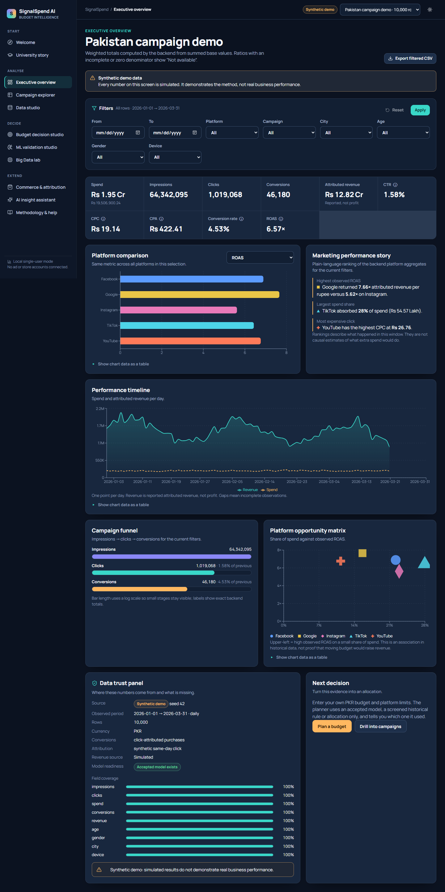

---

## Contents
1. [Features](#features)
2. [Screens](#screens)
3. [Test results](#test-results)
4. [Screenshots](#screenshots)
5. [How the numbers are calculated](#how-the-numbers-are-calculated)
6. [Big Data lab results](#big-data-lab-results)
7. [Machine learning](#machine-learning)
8. [Budget recommendation engine](#budget-recommendation-engine)
9. [Commerce & attribution](#commerce--attribution)
10. [AI insight assistant (NVIDIA)](#ai-insight-assistant-nvidia)
11. [Architecture & tech stack](#architecture--tech-stack)
12. [Project structure](#project-structure)
13. [Run it locally](#run-it-locally)
14. [Environment variables](#environment-variables)
15. [Tests & quality checks](#tests--quality-checks)
16. [Deployment (Vercel)](#deployment-vercel)
17. [Security & privacy](#security--privacy)
18. [Limitations](#limitations)
19. [Troubleshooting](#troubleshooting)
20. [Documentation index](#documentation-index)

---

## Features
| Area | What you can do |
|---|---|
| **Data** | Generate a reproducible synthetic dataset (seed, dates, platforms), or import your own campaign CSV through preview → column mapping → validation → confirm. Meta, Google and TikTok export profiles, daily or weekly data, currency conversion with a verified rate, and duplicate handling. |
| **Analytics** | Spend, impressions, clicks, conversions, attributed revenue, CTR, CPC, CPA, conversion rate and ROAS. Filters by date, platform, campaign, city, age, gender and device. Grouping, sorting, paging and CSV export. |
| **Insights** | Marketing performance story, campaign funnel, platform opportunity matrix (spend share vs ROAS), data trust panel (coverage, attribution, currency, model status), and Explain-my-KPI with live worked examples. |
| **Big Data lab** | The same aggregation in Pandas, local MapReduce and local PySpark at 10K / 100K / 1M / 10M rows. At least 3 measured repeats, each repeat checked against a reference answer, with memory, setup time, environment and JSON/CSV export. |
| **Machine learning** | XGBoost revenue model on a chronological train / validation / holdout split. It must beat a train-only baseline before it is used. Includes per-platform errors, feature importance, re-evaluation of the saved model and export. |
| **Budget engine** | Enter any PKR budget (e.g. 1,000,000). Choose a method, set min/max share or PKR per platform, and get an exact allocation with a reason per platform. Same-budget comparisons, response curves, saved plans, scenario comparison, CSV/JSON export and print. |
| **Commerce** | Import store orders and cost CSVs, map UTMs to campaigns, and compare store sales with ad-reported revenue (matched / unmatched / ambiguous). Includes cost coverage and contribution profit, plus a profit-aware plan when strict evidence gates pass. |
| **AI assistant** | Optional plain-language explanation of a report via NVIDIA. You see and approve the exact summary before anything is sent. |
| **UX** | Dark and light themes (no flash), responsive from 320 px to wide desktop, keyboard-accessible, a table alternative for every chart, and platform colours paired with shapes. |

## Screens
| Route | Screen |
|---|---|
| `/` | Welcome: generate the demo, upload a CSV, or read the methodology |
| `/overview` | Executive overview: KPI strip, platform comparison, timeline, funnel, opportunity matrix, trust panel |
| `/campaigns` | Campaign explorer: group by campaign/platform/date/city/age/gender/device, sort, page, export |
| `/data` | Data studio: saved datasets, synthetic generator, CSV import wizard |
| `/budget` | Budget decision studio |
| `/models` | ML validation studio |
| `/lab` | Big Data lab |
| `/commerce` | Commerce & attribution |
| `/assistant` | AI insight assistant |
| `/methodology` | Formulas, data rules, ML, budget engine, Big Data method, scope |

## Test results
Every number below comes from the recorded result files in [`docs/`](docs/) (pytest output, browser-journey JSON, page-QA JSON and Big Data evidence). The card is regenerated with `node scripts/test-results-card.mjs`.

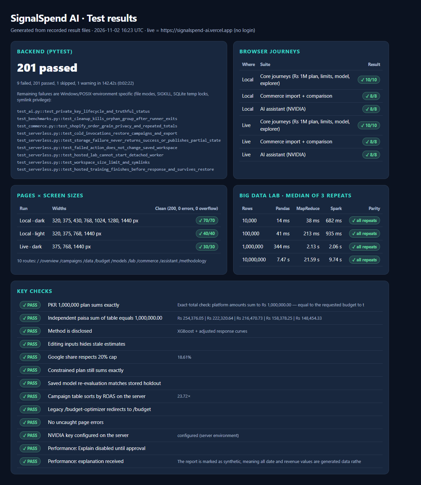

| Suite | Local | Live (no login) |
|---|---|---|
| Backend pytest | 201 passed (9 Windows-only environment failures, 1 skipped) | n/a |
| Core journeys: Rs 1M exact plan, 20% cap, stale estimates, model re-evaluation, explorer, redirects | 10/10 | 10/10 |
| Commerce import + comparison | 8/8 | 8/8 |
| AI assistant (real NVIDIA explanations, approval gate) | 8/8 | 8/8 |
| Pages × screen sizes (HTTP 200, 0 console errors, 0 overflow) | 70/70 dark, 40/40 light | 30/30 |
| Big Data lab: 4 scales × 3 engines × 3 repeats parity | all correct | n/a (runs locally) |

## Screenshots
| | |
|---|---|
| **Welcome** 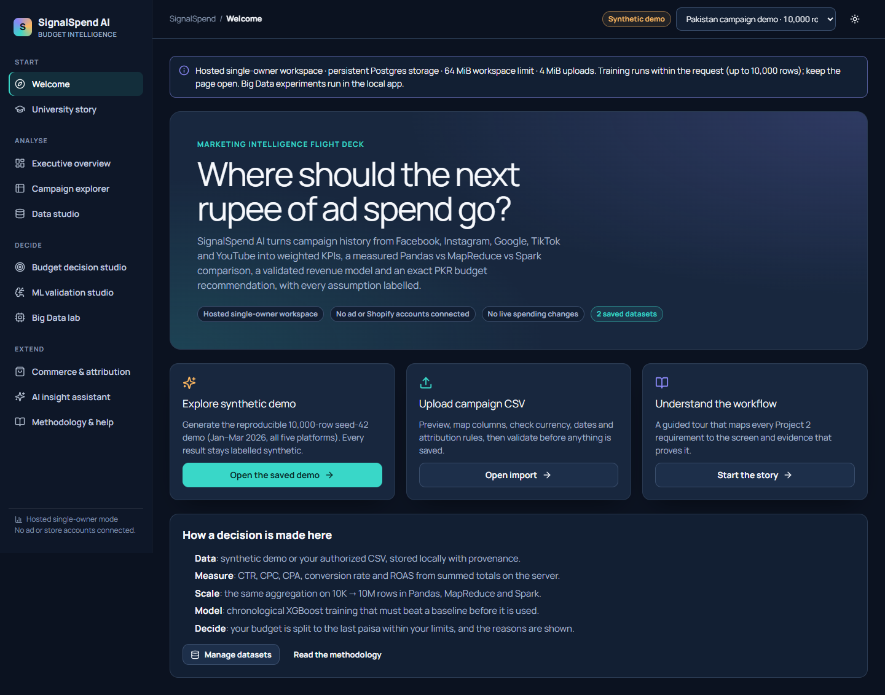 | **Executive overview** 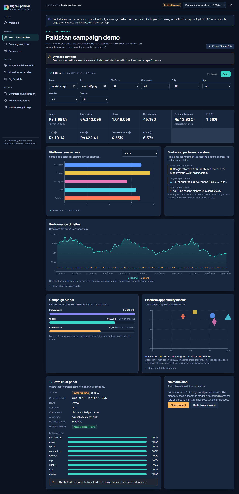 |
| **Budget: Rs 1,000,000 exact plan** 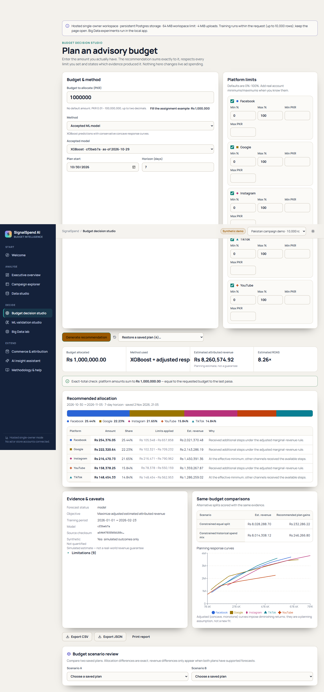 | **ML validation studio** 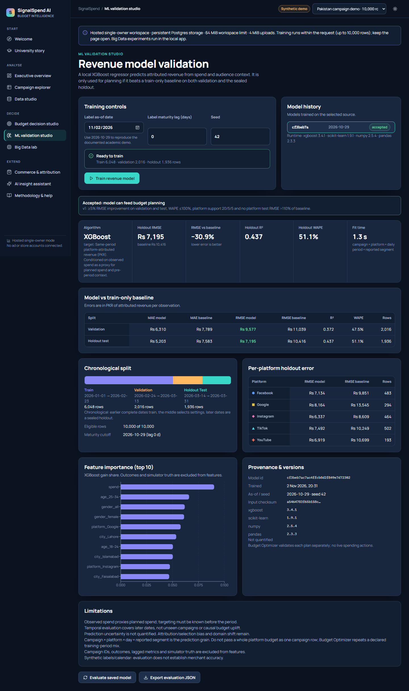 |
| **Big Data lab (local, 10K → 10M)** 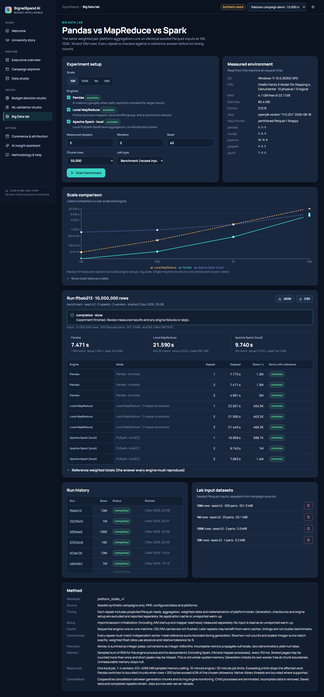 | **Campaign explorer** 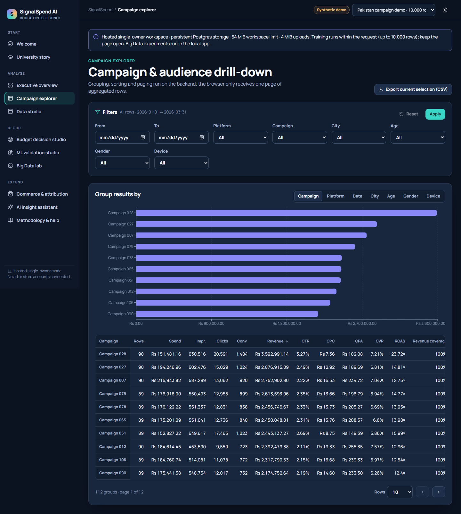 |
| **Commerce & attribution** 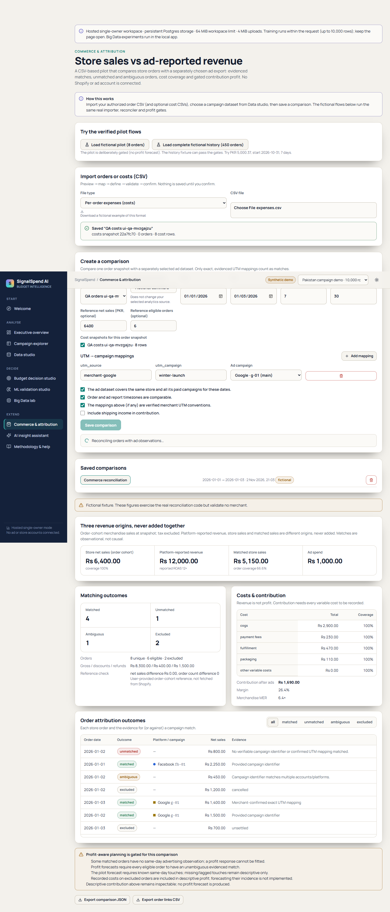 | **AI insight assistant (NVIDIA)** 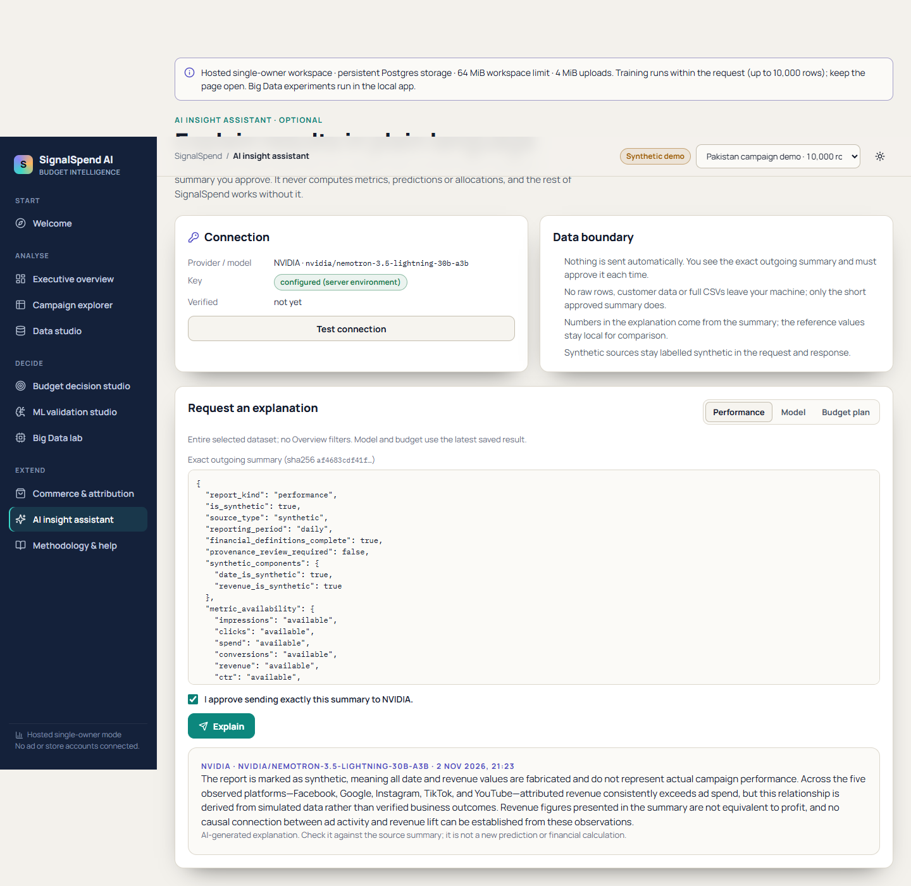 |
| **Data studio** 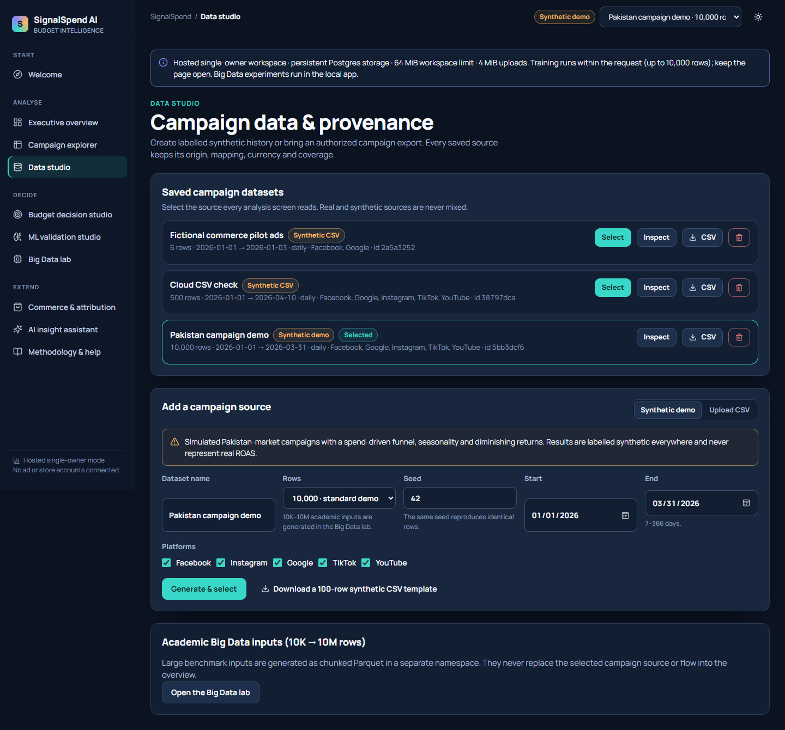 | **Light theme** 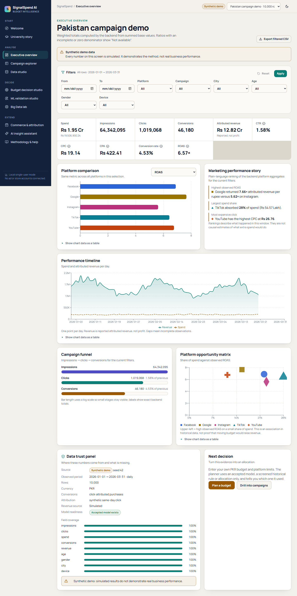 |

**Mobile (375 px):** [Overview](docs/screenshots/cloud-overview-375.png) · [Budget](docs/screenshots/cloud-budget-375.png) · [Lab](docs/screenshots/cloud-lab-375.png) · [Commerce](docs/screenshots/cloud-commerce-375.png) · [Assistant](docs/screenshots/cloud-assistant-375.png)

## How the numbers are calculated
All aggregates are computed on the server from **summed base values**. Per-row rates are never averaged.

| KPI | Formula |
|---|---|
| CTR % | 100 × Σ clicks ÷ Σ impressions |
| CPC | Σ spend ÷ Σ clicks |
| CPA | Σ spend ÷ Σ conversions |
| Conversion rate % | 100 × Σ conversions ÷ Σ clicks |
| ROAS | Σ attributed revenue ÷ Σ spend |

- A missing value or zero denominator shows **Not available**, never a fake 0.
- Revenue is **reported attributed revenue**, not profit.
- All money is PKR. Foreign currency needs a verified exchange rate.
- Synthetic data is labelled synthetic on every screen.

**Data fields:** `date, campaign, platform, impressions, clicks, spend, conversions, revenue, age, gender, city, device`. Optional: `campaign_id, account_id, attribution_window, conversion_definition`.

Demo dataset (seed 42, 10,000 rows, 2026-01-01 → 2026-03-31): CTR 1.58%, CPC Rs 19.14, CPA Rs 422.41, CVR 4.53%, ROAS 6.57× (simulated).

## Big Data lab results
Median of 3 measured repeats (setup excluded), seed 42, 2 workers, on one Windows laptop (10 cores). Every repeat matched the reference totals.

| Rows | Pandas | Local MapReduce | Local Spark |
|---|---|---|---|
| 10,000 | 0.014 s | 0.038 s | 0.682 s |
| 100,000 | 0.041 s | 0.213 s | 0.935 s |
| 1,000,000 | 0.344 s | 2.128 s | 2.063 s |
| 10,000,000 | 7.471 s | 21.590 s | 9.740 s |

On a single machine Pandas is fastest at every scale. Spark pays about 10 s of JVM start-up, overtakes MapReduce from about 1M rows, and is about 2.2× faster than MapReduce at 10M. These are single-machine results, not cluster benchmarks. Raw evidence: [`docs/evidence/`](docs/evidence/).

**Method:** the inputs are seeded synthetic rows written as chunked Snappy Parquet (10M = 200 parts, 201 MiB). The workload is per-platform sums plus weighted ratios. The engines are Pandas (in-memory, or chunked when large), MapReduce (process mappers → shuffle → reducer) and PySpark DataFrame (`local[2]`). Parity is checked with exact scaled-integer comparison.

## Machine learning
- **Model:** XGBoost regressor predicting attributed revenue from spend, platform, date context and audience. Outcomes and simulator ground truth are excluded from features.
- **Split:** chronological train → validation (settings) → sealed holdout. Labels must be mature at the as-of date.
- **Acceptance gate:** ≥5% RMSE improvement over the baseline on validation **and** holdout, WAPE ≤100%, minimum platform support, and no platform more than 110% of the baseline error.
- **Demo result** (as-of 2026-10-29): **accepted**. Holdout RMSE 7,195 vs baseline 10,416, R² 0.437. Re-evaluating the saved artifact gives identical numbers locally and in the cloud.

## Budget recommendation engine
1. You enter the budget. There is no default amount, and the "Rs 1,000,000" button just fills the example.
2. **Methods:** Automatic (accepted model → screened baseline → allocation only), Accepted ML model, Screened statistical baseline, Historical baseline, or Allocation only.
3. Predictions become monotone **concave response curves** (diminishing returns). A greedy allocator then gives each paisa increment to the platform with the highest marginal estimate, within every min/max share and PKR limit.
4. The total always equals the budget to the paisa. The app shows an exact-total check, and the tests re-add the amounts independently.
5. When the forecast is not supported, revenue/ROAS show **Not available** and the budget is still split within your limits.

Example (Rs 1,000,000, 7 days, XGBoost): Facebook Rs 254,376.05 · Google Rs 222,320.64 · Instagram Rs 216,470.73 · YouTube Rs 158,378.25 · TikTok Rs 148,454.33 (simulated data, advisory).

## Commerce & attribution
- Import Shopify line-item or generic order CSVs, plus per-order expense or SKU cost CSVs. Personal columns are discarded before staging.
- Compare one order snapshot with one ad dataset. Only evidenced matches count (campaign IDs or verified UTM mappings).
- Three revenue origins (store net sales, platform-reported revenue, matched store sales) are shown separately and never added together.
- Contribution profit is shown only when costs are recorded. Profit-aware plans appear only when strict evaluation gates pass.
- Two fictional fixture flows are built in ("pilot" is gated; "history" passes the gates).

## AI insight assistant (NVIDIA)
- Uses `nvidia/nemotron-3.5-lightning-30b-a3b` via NVIDIA's API. The key lives on the server only (`NVIDIA_API_KEY`).
- Choose a report (performance, model or budget plan). You see the **exact** outgoing summary and its SHA-256, and must tick an approval box before anything is sent.
- No raw rows, customer data or CSVs leave the server. The model explains numbers but never calculates or changes them.
- In the public demo, saving or removing keys is disabled. Every other feature works without a key.

## Architecture & tech stack
```
Browser → Next.js 16 (React 19, TypeScript, Tailwind 4, Recharts)
            ├─ lib/api.ts       typed client for /api/v1
            └─ proxy.ts         access guard (public demo / owner login)
        → /api/v1/* → FastAPI (Python 3.12)
            ├─ data/         generator, CSV import, schema mapping, provenance
            ├─ analytics/    weighted KPIs, filters, grouping
            ├─ ml/           XGBoost training/evaluation, artifacts
            ├─ optimization/ concave curves + exact-paisa allocation
            ├─ benchmarks/   Pandas | MapReduce | PySpark engines, worker, parity
            ├─ commerce/     orders/costs import, reconciliation, profit gates
            ├─ ai/           NVIDIA boundary (approved summaries only)
            └─ hosting/      Postgres snapshot persistence for serverless
        → SQLite catalog + Parquet (local)  |  Neon Postgres snapshot (Vercel)
```
Stack: Next.js 16.4, React 19.3, Tailwind 4.3, Recharts 3.10, FastAPI 0.162, Pydantic 2, pandas 2.3, PyArrow, XGBoost 3.4, scikit-learn, SciPy (HiGHS), PySpark 4.2, Temurin Java 17, Playwright, pytest, Ruff, ESLint.

## Project structure
```
backend/src/ads_optimizer/   Python services and FastAPI app
backend/tests/               pytest suite (incl. regression tests)
frontend/app/                Next.js routes (one folder per screen)
frontend/components/         screens and UI primitives
frontend/lib/                typed API adapter, formatting
frontend/api/index.py        Vercel Python function entry
scripts/dev.mjs              starts backend + frontend (Windows/macOS/Linux)
scripts/qa-screens.mjs       every route × 7 widths: status, console errors, overflow, screenshots
scripts/e2e-flows.mjs        browser journeys (Rs 1M plan, limits, model, explorer)
scripts/e2e-commerce.mjs     commerce import + comparison journey
docs/                        architecture, API inventory, design system, tests, deployment, evidence
```

## Run it locally
Requirements: Node ≥ 20.9, Python 3.11–3.12, and Java 17/21/25 for Spark (optional).

**Windows (PowerShell)**
```powershell
py -3.12 -m venv .venv
.\.venv\Scripts\python -m pip install -r requirements.lock.txt
.\.venv\Scripts\python -m pip install --no-deps -e .
npm --prefix frontend ci
npm run dev
```
**macOS / Linux / WSL2**
```sh
python3.12 -m venv .venv
.venv/bin/python -m pip install -r requirements.lock.txt
.venv/bin/python -m pip install --no-deps -e .
npm --prefix frontend ci
npm run dev
```
Open http://127.0.0.1:3000 (API docs: http://127.0.0.1:8000/docs).

**Spark:** unzip a Temurin 17 JRE/JDK (https://adoptium.net) into `.runtime/` or set `JAVA_HOME`. `npm run dev` finds it automatically. Without Java, Pandas and MapReduce still run, and the app shows Spark as unavailable with the reason.

**Quick demo:**
1. Welcome → Generate demo data.
2. ML studio → as-of `2026-10-29`, lag 0 → Train.
3. Budget studio → `1000000` → Generate.
4. Big Data lab → choose a scale → Start benchmark.

## Environment variables
Names only; never commit values. See [`.env.example`](.env.example).

| Name | Where | Purpose |
|---|---|---|
| `API_ORIGIN` | local | Backend URL for the Next.js dev proxy (default `http://127.0.0.1:8000`) |
| `ADS_DATA_DIR` | local | Workspace folder (use a disposable one for tests) |
| `JAVA_HOME` | local | Java for Spark |
| `NVIDIA_API_KEY` | server | Optional AI explanations |
| `ADS_PUBLIC_DEMO` | Vercel | `1` = login-free demo (deletes and key changes refused) |
| `ADS_ACCESS_PASSWORD` | Vercel | Owner login (≥32 chars) when public demo is off |
| `ADS_ALLOWED_ORIGINS` | Vercel | Allowed origin for write requests |
| `DATABASE_URL` / `POSTGRES_URL` | Vercel | Neon Postgres (injected by the integration) |
| `VERCEL_SUPPORT_LARGE_FUNCTIONS` | Vercel | `1`, for the Python data libraries |

## Tests & quality checks
```sh
python -m pytest -q                 # backend (use the .venv python)
python -m ruff check backend scripts
npm run check                       # TypeScript + ESLint
npm run build                       # production build
npm run test:ui                     # all routes × 7 widths
npm run test:e2e                    # core browser journeys
npm run test:e2e:commerce           # commerce journey
```
To run the browser scripts against the live site, set `APP_URL=https://optiscale-ai.vercel.app`. Latest results are in [docs/test-report.md](docs/test-report.md).

## Deployment (Vercel)
Next.js app with a Python function. Vercel settings: root directory `frontend`, files outside root included, and a free Neon Postgres for workspace persistence. Hosted limits: 64 MiB workspace, 4 MiB uploads, training up to 10,000 rows, and no Big Data lab (it runs locally). Full steps and evidence: [docs/deployment.md](docs/deployment.md). Redeploy with `vercel deploy --prod`.

## Security & privacy
- The public demo needs no login, but it **refuses all deletes and API-key changes**, keeps the cross-site write block (CSRF) and keeps upload size limits.
- With the public demo off, the owner login (Basic auth) is enforced by both Next.js and Python.
- Secrets stay in server environment variables and are never placed in the browser bundle or Git.
- CSV exports neutralise spreadsheet formulas, and personal columns in commerce imports are discarded.
- Security headers: `X-Frame-Options: DENY`, `nosniff`, `Referrer-Policy: same-origin`.

## Limitations
- Demo data is simulated; it says nothing about real advertisers' ROAS.
- Results are observational associations, not causal uplift; plans are advisory and change no real ad spend.
- No live connections to ad platforms or Shopify.
- The public demo is one shared workspace: anyone can add data, and data may be reset.
- Spark timings come from one machine, not a cluster.
- Full list: [docs/limitations.md](docs/limitations.md).

## Troubleshooting
| Problem | Fix |
|---|---|
| "Backend unavailable" banner | Start both services with `npm run dev` from the repo root |
| Spark shows unavailable | Install Java 17/21/25 (see Spark above) and restart |
| Port 3000/8000 busy | Stop the other process |
| Git Bash mangles `/routes` in scripts | Prefix the command with `MSYS_NO_PATHCONV=1` |
| Delete returns 403 on the live site | Expected: deletes are disabled in the public demo |

## Documentation index
[Architecture](docs/architecture.md) · [API inventory](docs/03-api-contract-inventory.md) · [Requirements matrix](docs/02-assignment-compliance-matrix.md) · [Design system](docs/06-design-system.md) · [UI journeys](docs/07-ui-journeys.md) · [Backend change log](docs/08-backend-change-log.md) · [Deployment](docs/deployment.md) · [Test report](docs/test-report.md) · [Limitations](docs/limitations.md) · [Progress](docs/PROGRESS.md)
